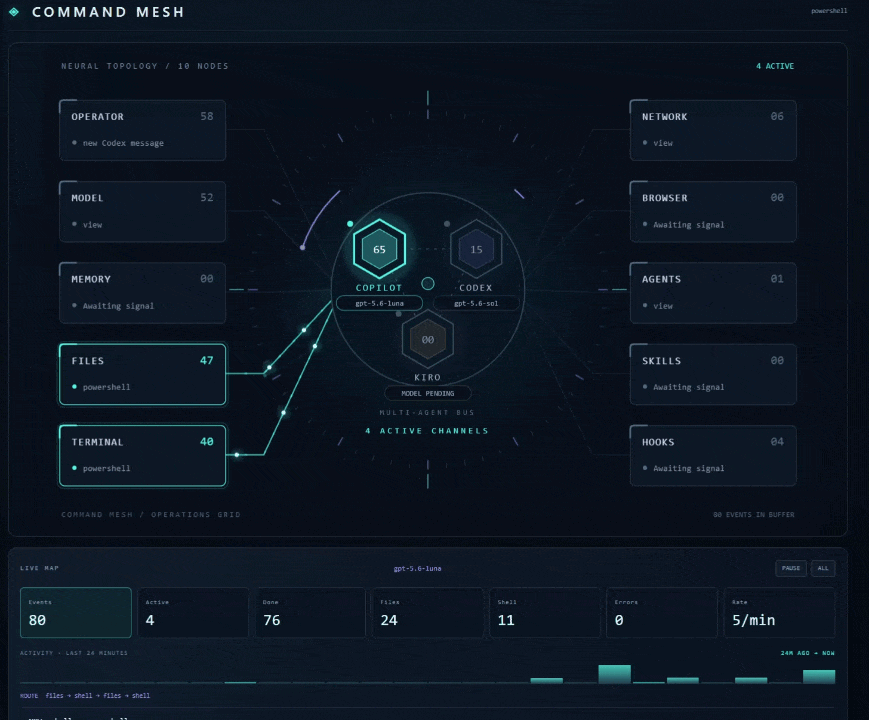

# Command Mesh

Live visual telemetry for Codex, Copilot, Kiro, and other coding agents. Command Mesh renders prompts, tools, files, terminals, browser activity, subagents, and model state as a dockable animated operations grid.

<p align="center">
  
</p>

<p align="center"><em>One live command surface. Every agent, tool, and signal in motion.</em></p>

## Attribution

Command Mesh is based on the original [Lot Map](https://github.com/alexeyw/lot-map) created by [Aleksei Volodin](https://github.com/alexeyw) and used under the MIT License. The VS Code, Codex, Copilot, and Kiro integrations and additional modifications are by Jeremy Hamilton.

## Install in Kiro

1. Open this folder in Kiro.
2. The reliable install path is to run `powershell -ExecutionPolicy Bypass -File .\package-vsix.ps1`.
3. In Kiro, open the Command Palette and choose **Extensions: Install from VSIX...**, then select `command-mesh-0.1.0.vsix`.
4. Reload Kiro. Run **Command Mesh: Open Activity Grid** from the Command Palette.

`F5` may open an extension-host window, but Kiro's debugger does not always register local workspace extensions. Installing the VSIX avoids that limitation.
5. Keep the workspace hook file [.kiro/hooks/command-mesh.json](.kiro/hooks/command-mesh.json) enabled.

## Install in VS Code

1. Run the same packaging command from the integrated terminal.
2. Open VS Code's Command Palette and choose **Extensions: Install from VSIX...**.
3. Select `command-mesh-0.1.0.vsix`, reload VS Code, then run **Command Mesh: Open Activity Grid**.
4. For a larger browser view, run **Command Mesh: Open Web Dashboard**. It opens a local-only dashboard at `127.0.0.1` using the same live state.

The extension runs in both editors from the same VSIX. VS Code does not expose Copilot's private agent/tool event stream to extensions. Command Mesh tracks observable work through workspace events and local agent session streams. Kiro additionally provides prompt and tool events through its hook integration.

The center is a permanent three-provider bus with separate `COPILOT`, `CODEX`, and `KIRO` cores. Each core keeps its own model metadata, buffered event count, and live/idle state.

The hook bridge writes only station names, short labels, timestamps, and counts to `.kiro/command-mesh/state.json`. It does not persist prompt text, tool arguments, file contents, or credentials. Existing `.kiro/lot-map/state.json` data is migrated automatically.

## Live GitHub Copilot CLI bridge

For full agent activity in VS Code, run GitHub Copilot CLI from the VS Code integrated terminal. The repository hook configuration at [.github/hooks/command-mesh.json](.github/hooks/command-mesh.json) sends Copilot CLI session, prompt, tool, completion, and error events to the shared Command Mesh state file.

```powershell
copilot
```

Keep Command Mesh open, then use Copilot CLI in that terminal. The extension also tails Copilot CLI's local machine-readable session stream at `%USERPROFILE%\.copilot\session-state\*\events.jsonl`. That stream contains the actual selected model on assistant and tool events, so the mesh can show model names such as `gpt-5.6-luna`; it does not scrape the rendered terminal UI.

This is separate from the built-in Copilot Chat panel: VS Code does not expose that panel's private event stream to extensions. The bridge intentionally stores only the model name, event type, station, short tool name, status, and timestamps.

## Live ChatGPT / Codex bridge

Command Mesh also follows local Codex sessions from `%USERPROFILE%\.codex\sessions`. Sign in to Codex with the ChatGPT account that owns your eligible Plus or Pro plan, then use Codex in this workspace. The dedicated `CODEX` core records turn, model, tool, completion, and station metadata without replacing the other provider cores.

The bridge only follows sessions whose working directory matches the open workspace. It does not copy prompt text, tool arguments, tool output, response text, OAuth tokens, or other credentials into Command Mesh state.

## What lights up

| Station | When |
| --- | --- |
| You | prompts submitted to Kiro |
| Model | completed Kiro turns |
| Memory | tools or paths whose names indicate memory/recall |
| Files | file tools and saved files |
| Shell | terminal and command tools |
| Network | web fetch, search, and HTTP tools |
| Browser | Playwright and interactive browser automation |
| Agents | agent and subagent tools |
| Skills | skill loading and skill-backed workflows |
| Hooks | project hook activity and hook failures |

## Development

The extension has no runtime dependencies. Validate the bridge with:

```powershell
node --check extension.js
node --check .kiro\command-mesh\hook.js
node --check .github\command-mesh-copilot-hook.js
```

Kiro hook event names and payloads can evolve. The bridge deliberately tolerates missing fields and sanitizes labels before writing state.

## License

[MIT](LICENSE)
