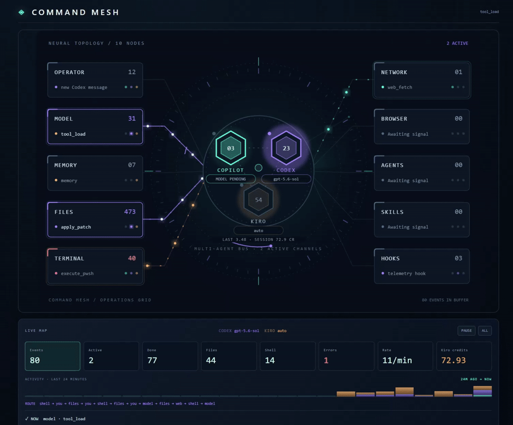

# Command Mesh

Live visual telemetry for Codex, Copilot, Kiro, and other coding agents. Command Mesh renders prompts, tools, files, terminals, browser activity, subagents, and model state as a dockable animated operations grid.

<p align="center">
  
</p>

<p align="center"><a href="docs/command-mesh-demo.mp4">Watch the full-resolution video (MP4)</a></p>

<p align="center"><em>One live command surface. Every agent, tool, and signal in motion.</em></p>

## Attribution

Command Mesh is based on the original [Lot Map](https://github.com/alexeyw/lot-map) created by [Aleksei Volodin](https://github.com/alexeyw) and used under the MIT License. The VS Code, Codex, Copilot, and Kiro integrations and additional modifications are by [Deemer15](https://github.com/Deemer15).

## Requirements

- Kiro or VS Code 1.85 or later.
- [Node.js](https://nodejs.org/) on your `PATH`. The Kiro and Copilot CLI hooks run `node` for every event.
- Windows PowerShell to build the VSIX with `package-vsix.ps1`.
- An open workspace folder. The extension tracks the first workspace folder only.

## Install in Kiro

1. Open this folder in Kiro.
2. Build the package:

   ```powershell
   powershell -ExecutionPolicy Bypass -File .\package-vsix.ps1
   ```

   This creates `command-mesh-0.1.0.vsix` in the project root.
3. Open the Command Palette and choose **Extensions: Install from VSIX...**, then select `command-mesh-0.1.0.vsix`.
4. Reload Kiro (**Developer: Reload Window**).
5. Keep the workspace hook file [.kiro/hooks/command-mesh.json](.kiro/hooks/command-mesh.json) enabled. You can check it in the **Agent Hooks** section of the Kiro explorer.
6. Run **Command Mesh: Open Activity Grid** from the Command Palette.

Steps 3 and 4 can also be done from a terminal. Installing into both editors this way also replaces an older build in place:

```powershell
kiro --install-extension .\command-mesh-0.1.0.vsix --force
code --install-extension .\command-mesh-0.1.0.vsix --force
```

Reload each window afterwards. A window that has not reloaded keeps running the previous build.

`F5` launches an extension-host window from [.vscode/launch.json](.vscode/launch.json), but Kiro's debugger does not always register local workspace extensions. Installing the VSIX avoids that limitation.

## Install in VS Code

1. Build the package with the same command as above.
2. Open the Command Palette and choose **Extensions: Install from VSIX...**.
3. Select `command-mesh-0.1.0.vsix`, reload VS Code, then run **Command Mesh: Open Activity Grid**.

The same VSIX runs in both editors. VS Code does not expose Copilot Chat's private agent and tool event stream to extensions, so in VS Code Command Mesh tracks workspace events, terminal commands, and the local Copilot CLI and Codex session streams described below. Kiro additionally sends prompt and tool events through its hook integration.

## Commands

| Command | What it does |
| --- | --- |
| **Command Mesh: Open Activity Grid** | Opens the animated grid in an editor panel beside your code. |
| **Command Mesh: Open Web Dashboard** | Starts a local web server and opens a larger dashboard in your browser, with KPIs, an activity timeline, and an event inspector. |

The web dashboard listens on `127.0.0.1` only, on a random free port chosen each time the extension starts the server. It has no authentication, so any process on your machine can read its `/state` endpoint while it runs. It stops when the editor window closes.

## How it works

Several independent writers append events to one shared file, `.kiro/command-mesh/state.json`, in the open workspace. The grid and the web dashboard read that file and redraw about every 800 ms.

| Writer | Source | Provider core |
| --- | --- | --- |
| Kiro hook, [.kiro/command-mesh/hook.js](.kiro/command-mesh/hook.js) | Kiro prompt, tool, file-save, and stop hooks | `KIRO` |
| Copilot CLI hook, [.github/command-mesh-copilot-hook.js](.github/command-mesh-copilot-hook.js) | Copilot CLI hooks in [.github/hooks/command-mesh.json](.github/hooks/command-mesh.json) | `COPILOT` |
| Copilot stream bridge, in `extension.js` | `%USERPROFILE%\.copilot\session-state\*\events.jsonl` | `COPILOT` |
| Codex stream bridge, in `extension.js` | `%USERPROFILE%\.codex\sessions` | `CODEX` |
| Workspace watcher, in `extension.js` | File create, change, save, and delete events, and terminal commands | current provider |
| Kiro usage reader, in `extension.js` | Kiro's session log for this workspace: selected model and credits per turn | `KIRO` |
| Presence check, in `extension.js` | Running processes, every 10 s | all three |

Kiro's hook payload does not include the model, so the Kiro hook reads `modelId` from the matching `~/.kiro/sessions/*/<session_id>/session.json`. When Kiro is set to **Auto**, that file stores `auto` and the server picks the model, so the `KIRO` core shows `auto`.

The file keeps the last 80 events plus a running count per station. The center of the grid is a three-provider bus with separate `COPILOT`, `CODEX`, and `KIRO` cores. Each core shows its own model name, how many of the buffered events are its own, and whether it is working, idle, or offline.

Existing `.kiro/lot-map/state.json` data from Lot Map is copied to the new location automatically.

## Live GitHub Copilot CLI bridge

For full agent activity in VS Code, run GitHub Copilot CLI from the integrated terminal:

```powershell
copilot
```

Keep Command Mesh open, then use Copilot CLI in that terminal. Two things feed the mesh:

- **Repository hooks.** [.github/hooks/command-mesh.json](.github/hooks/command-mesh.json) sends session, prompt, tool, completion, and error events to the state file. While an editor window is reading the session stream below, the hook leaves prompts and tool calls to it (the stream has the real model and call ids) and records only session start, completion, and errors. The `preToolUse` hook always answers `allow`, and recording errors are swallowed, so telemetry never blocks a tool.
- **Session stream.** The extension tails Copilot CLI's machine-readable stream at `%USERPROFILE%\.copilot\session-state\*\events.jsonl`. That stream carries the selected model on assistant and tool events, so the mesh can show names such as `gpt-5.6-luna`. It does not scrape the terminal UI.

The session stream is read for every Copilot CLI session on the machine, not only sessions started in this workspace.

This is separate from the built-in Copilot Chat panel, whose event stream VS Code does not expose to extensions.

## Live ChatGPT / Codex bridge

Command Mesh also follows local Codex sessions from `%USERPROFILE%\.codex\sessions`. Sign in to Codex with a ChatGPT account whose plan includes Codex, then use Codex in this workspace. The `CODEX` core records turn, model, tool, completion, and station metadata.

The bridge only follows sessions whose working directory matches the open workspace folder exactly.

## Privacy

What is stored depends on the source. Everything stays in `.kiro/command-mesh/state.json` in your workspace, which is listed in `.gitignore`. Nothing is sent over the network.

| Source | Stores | Does not store |
| --- | --- | --- |
| Kiro hook | Station, short label (tool name, or the last two path segments for saved files), status, timestamps, counts, model name | Prompt text, tool arguments, file contents |
| Copilot CLI hook | Station, short label, status, timestamps, counts, model name | Prompt text, tool arguments, file contents |
| Kiro usage reader | Selected model, credits for the last turn and the session, time of the last turn | Prompt text, responses, tool calls, anything else from the session log |
| Presence check | Whether Kiro, Codex, and Copilot are running (true or false) | Process list, command lines |
| Codex stream bridge | Station, short label, tool name, status, timestamps, model name | Prompt text, tool arguments, tool output, response text, OAuth tokens |
| Copilot stream bridge | Station, label, status, timestamps, model name, **plus prompt text and tool arguments** (see below) | Tool output, response text |

The Copilot stream bridge keeps prompt text and tool arguments so the web dashboard's event inspector can show them. Before saving, it:

- removes `<memories>`, `<system_reminder>`, and `<current_datetime>` blocks;
- replaces values that follow `token`, `secret`, `password`, `api_key`, or `authorization` with `[REDACTED]`;
- flattens newlines and cuts each value to 600 characters, and keeps at most 12 arguments per tool call.

This scrubbing is pattern-based and will not catch every secret. If you paste credentials into Copilot CLI prompts, assume a scrubbed copy can land in `state.json`. Delete the file to clear it.

## Reading the grid

- **Colors mean agents.** Copilot is cyan, Codex is violet, Kiro is amber. Cores, station cards, routes, packets, the ticker, the activity bars, and the event feed all use the same colors. When two agents work on the same station, their packets alternate on one route.
- **Station pips.** The three dots on each card show which agents have used that station (dim) and which are using it now (bright).
- **Core states.** A working core pulses. An open but quiet core breathes slowly. A dashed gray core marked `OFFLINE` means the app is not running. The extension checks running processes (`Kiro`, `codex`, `copilot`) every 10 seconds. Copilot also counts as running if one of its session logs changed in the last two minutes, and any agent with activity in the last two minutes is never shown offline.
- **Turn complete.** When an agent finishes a turn, a shockwave rings out from its core.
- **Errors.** A failed tool shakes its station card and flashes it red.
- **Kiro credits.** Under the Kiro core: credits used by the last turn and the current session, with a `+N CR` burst when a turn finishes. The figures come from the `usage_summary` records in Kiro's session log (`~/.kiro/sessions/*/<session>/messages.jsonl`).
- **Ticker.** The line under the bus types out the current operation, e.g. `> KIRO :: SHELL :: execute_pwsh`.

Below the grid, both the panel and the web dashboard show each agent's model, a Kiro credits KPI, activity bars stacked by agent, and an event feed marked with each agent's color. The web dashboard also lets you pause, filter by minute on the timeline, and expand an event to inspect it.

With reduced motion turned on in your OS, the animations are off and the one-shot effects are hidden.

## What lights up

| Station | When |
| --- | --- |
| You | prompts submitted to an agent |
| Model | completed agent turns, and tools whose names match no other station |
| Memory | tools whose names mention memory, remember, or recall |
| Files | file tools (read, write, edit, replace, grep, glob, list) and file changes in the workspace |
| Shell | terminal and command tools, and commands run in the editor's terminal |
| Network | web fetch, search, HTTP, and (for Kiro and Copilot) browser tools |
| Browser | Codex browser automation (Playwright, browser tabs) |
| Agents | agent and subagent tools |
| Skills | Codex reading skill files |
| Hooks | Copilot CLI errors, and Codex calls to the Command Mesh hook scripts |

Stations are chosen by matching tool names against keyword patterns, and each source has its own patterns. An unusual tool name can land on an unexpected station. Kiro and Copilot browser tools currently land on Network, so Browser and Skills only light up for Codex.

## Troubleshooting

| Symptom | Check |
| --- | --- |
| The grid is empty | Make sure a folder is open, then do something visible such as saving a file. Check that `.kiro/command-mesh/state.json` exists and is changing. |
| Kiro tools appear but prompts and turn completions do not | Check that `.kiro/hooks/command-mesh.json` uses the triggers `UserPromptSubmit`, `PreToolUse`, `PostToolUse`, `PostFileSave`, and `Stop`, and that the hooks are enabled. |
| Hooks fail with `node` not found | Install Node.js and restart the editor so the hooks see the updated `PATH`. |
| Copilot Chat activity is missing | Expected. Only Copilot CLI is tracked. |
| Codex activity is missing | Codex must be running in the same folder that is open in the editor. |
| The web dashboard URL stopped working | The port changes each time the server starts. Run **Command Mesh: Open Web Dashboard** again. |
| Many `state.json.*.tmp` files in `.kiro/command-mesh/` or `.kiro/lot-map/` | Left behind by failed writes in older versions. They are safe to delete. See [Known issues](#known-issues). |

## How tool calls are tracked

Each tool call is one entry. The start event opens it with status `run`, and the end event closes that same entry as `ok` or `err`:

- **Kiro hook.** Kiro's hook payload has no tool call id, so the end closes the oldest open call with the same tool name. If a payload ever includes an id (`tool_use_id` and similar), the hook matches on that instead.
- **Copilot CLI hook.** Closes the oldest open call with the same tool name. Used only when the extension's stream reader is not running.
- **Copilot stream bridge.** Matches on Copilot's `toolCallId`.
- **Terminal commands.** The finish closes the oldest open run of the same command.

Each hook closes only entries it created (marked with a `source` field), so writers never close each other's work. When a turn ends (Kiro `Stop`, Copilot `agentStop`), that hook closes any of its calls still marked running, in case an end event was missed. As a last safety net, the display treats anything still running after 15 seconds as finished.

## Known issues

- **File-watcher attribution.** Workspace file changes are tagged with whichever provider wrote last, not the agent that made the change. Windows may also report `change` events for files that were only read.
- **Kiro on Auto.** When Kiro's model is set to Auto, the server picks the model and nothing on disk records which one, so the `KIRO` core shows `auto`.
- **Two editors, one workspace.** The Kiro usage reader and the presence check run in every window, since they publish the same values. Only one window per workspace runs the Copilot and Codex stream readers and the disk watcher (whoever holds `.kiro/command-mesh/bridge.lock`). Terminal commands and document saves are still recorded by each window for its own activity.

## Concurrency

Several processes write `state.json`: the Kiro hook, the Copilot CLI hook, and the extension in each open editor. To keep them from clobbering each other:

- Each read-modify-write holds `state.json.lock`. A lock older than 3 seconds is treated as abandoned, and a writer that has waited 2 seconds goes ahead anyway.
- Writes go to a temp file that is renamed over `state.json`, with retries. A writer never writes the file in place, so readers never see half a file.
- If a writer cannot parse `state.json`, it skips its write rather than starting from an empty board. The panel keeps showing the last good board.
- Events that already exist on the board (same id) are skipped, so a second reader cannot double them.
- When the extension's Copilot stream reader is live, the Copilot CLI hook leaves prompts and tool calls to it and records only session start, stop, and errors.

Older versions left `state.json.*.tmp` files behind. They are safe to delete:

```powershell
Remove-Item .kiro\command-mesh\state.json.*.tmp -ErrorAction SilentlyContinue
```

## Uninstall and reset

- Uninstall **Command Mesh** from the Extensions view, or with `kiro --uninstall-extension local.command-mesh` / `code --uninstall-extension local.command-mesh`. The CLI can leave the folder behind in `~/.kiro/extensions` or `~/.vscode/extensions`; delete `local.command-mesh-0.1.0` there if it remains.
- Delete `.kiro/command-mesh/` (and `.kiro/lot-map/` if it exists) to clear recorded activity.
- Remove or disable `.kiro/hooks/command-mesh.json` and `.github/hooks/command-mesh.json` to stop the hooks from running.

## Repository layout

| Path | Purpose |
| --- | --- |
| `extension.js` | VS Code / Kiro extension: commands, panel, web dashboard, stream bridges, workspace watcher |
| `futuristic-renderer.js` | Draws the operations grid as SVG |
| `map-renderer.js` | Shared setup and classification helpers. Generated bundle of `hooks/map.ts` and `hooks/text.ts` from upstream Lot Map; edit the TypeScript sources and rebuild rather than editing this file by hand |
| `dashboard.css` | Styles for the panel's telemetry section and the web dashboard |
| `test/harness.js` | Scripted multi-agent session with checks. See [Development](#development) |
| `docs/` | The demo animation at the top of this README and its full-resolution MP4 |
| `.kiro/` | Kiro hook config and hook script |
| `.github/` | Copilot CLI hook config and hook script |
| `hooks/map.ts`, `hooks/text.ts`, `types/` | TypeScript sources of `map-renderer.js`, from upstream Lot Map |
| `.claude-plugin/`, `hooks/register.tsx`, `hooks/hooks.json`, `hooks/command-mesh.test.tsx` | Original Lot Map plugin for Claude Code, kept from upstream. Not packaged into the VSIX |
| `package-vsix.ps1` | Builds the VSIX without `vsce` |

## Development

The extension has no runtime dependencies. Check syntax with:

```powershell
node --check extension.js
node --check futuristic-renderer.js
node --check .kiro\command-mesh\hook.js
node --check .github\command-mesh-copilot-hook.js
```

### Test harness

```powershell
npm run harness   # ~15 s scripted session for all three agents; open the grid or web dashboard to watch
npm test          # the same session at 10x speed, as a quick pipeline check
```

[test/harness.js](test/harness.js) drives the real Kiro hook and writes Copilot and Codex events straight to the board, since their real sources are session logs in your home folder. It then checks the results: each event recorded once, every call closed, failures marked, stations right, other agents' models kept, credits updated, and no temp or lock files left. Afterwards it removes its events and restores the counters and credits. Pass `--keep` to leave them on the board.

The board holds 80 events, so the harness's events push your oldest real events out of the buffer, and cleanup cannot bring those back. Station totals are unaffected.

### Packaging

`package-vsix.ps1` copies only `extension.js`, `package.json`, `map-renderer.js`, `futuristic-renderer.js`, and `dashboard.css` into the VSIX. If you add a runtime file, add it to the script too.

Kiro and Copilot hook event names and payloads can change. The hook scripts tolerate missing fields and sanitize labels before writing state.

## License

[MIT](LICENSE)
